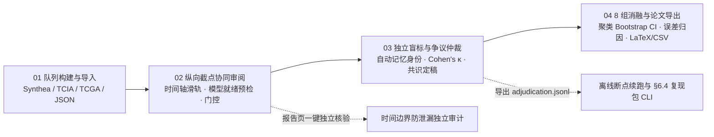

# MDT 医疗多智能体序贯协同决策系统：总体开发进程、使用逻辑与后续排期规划

> **项目定位**：毕业设计《面向重大疾病全病程的 MDT 医疗多智能体序贯协同决策框架设计与实现》核心软件与可复现实验平台（仓库：`mdt-demo/`，当前主分支 `main`）。  
> **关联文档**：[项目使用说明](../README.md) · [技术方案与开发计划](技术方案与开发计划.md) · [前端架构与 iOS 交互工程规范](前端架构与iOS交互工程规范.md) · [API 与事件契约](API与事件契约.md) · [验收记录](验收记录.md)

---

## 截至 2026-11-27 的实施进展

| 里程碑 | 已取证 | 下一项验收 |
| --- | --- | --- |
| M1 真实模型联调 | `deepseek-flash` 三场景冒烟使用 18 次 HTTP 请求，其中 2 个场景完成。单独复查齐备场景另用 4 次请求，发现历史更新被误判为当前冲突。修复后重放原始初审意见，结论为 `READY_FOR_REVIEW`。详见[验收记录](验收记录.md)。 | 修复后的门控仍待真实模型复验。首批部分响应缺少用量，尚不能据此确定每个截点的平均成本。 |
| M2 候选队列 | 从 ACRIN 6668 官方原表按登记号抽取第 13–42 例，与既有 12 例演示样本交集为 0。30 个病例族按 9 / 21 划分，开发集 122 个截点，留出集 281 个。结构化时序审计 403/403 通过，140 个同日截点保留人工复核提示。 | 结合先导成本、标注难度和时间粒度确定正式样本量和来源构成。 |
| M3 独立盲标 | 开发集 122 条任务均绑定所见材料指纹。两位标注人可使用同一任务文件分别填报，初标手册已随附。 | 收齐两份独立初标并归档争议仲裁及一致性报告。 |
| M4–M6 | 本轮只在开发集运行八组 Mock，共 976 条方法记录。从源 ZIP 在临时目录重建，开发集逐行分数、误差表、LaTeX 表和运行索引逐字节一致。 | 真实模型先导、正式测试和基于独立参考的论文结果待完成。 |

[队列清单与原表复算](../data/acrin_6668/README.md#2026-11-25-冻结的先导研究队列) · [盲标手册](../docs/开发集盲标手册.md) · [DeepSeek 联调命令](../README.md#deepseek-三场景联调)

## 一、总体开发进程全景复盘（已完成阶段 P0–P4）

截至 **2026-11-25**，项目已完成从早期单次命令行原型到**全功能纵向 MDT 研究控制台 + 论文级统计评测闭环**的五轮迭代演进，所有阶段成果均已合入 `main` 分支并通过自动化回归验证：

| 阶段 | 版本 / 里程碑 | 核心交付内容 | 验证状态 |
| --- | --- | --- | --- |
| **P0 · 原型奠基** | `V0.1 – V0.2`（`/legacy`） | 三角色基础协同 CLI 与 WebSocket 演示页，确立结构化意见、分歧识别与非诊疗安全免责声明基调。 | 已归档兼容保留 |
| **P1 · 纵向底座与持久化** | `V0.3 基线`（`3b6be4d`） | 升级为四专科（肿瘤内科、影像科、胸外科、病理科）事件驱动路由；实现 `(occurred_at, event_id)` 历史截点冻结、`unplaced_records` 无日期资料隔离、单轮快照隔离协商、证据门控、MongoDB 副本集事务、SSE `seq` 断线重放与 Fernet 凭据加密存储。 | 已完成 |
| **P2 · 多模态公开队列与防泄漏治理** | 跨分支融合（`codex` + `claude`） | 打通 **5 类医学数据接入**（内置合成病例、Synthea CSV ZIP、TCIA NSCLC 临床 CSV、TCGA/cBioPortal 宽表 TSV、研究 JSON）与真实医学附件（PNG/JPEG/WebP/PDF/DICOM Part 10，强制剥离 `0x0010` 患者隐私组）；严格杜绝伪造影像组学数值与未定位记录时序泄漏。 | 已完成 |
| **P3 · 科研评测、多人盲标与复现包闭环** | 科研增强版（`8c01eef` → `3b060de`） | 落地 **8 组受控配对实验**（`B0–B3` + `A1–A4`）、命名模型连接方案切换、**多人独立盲标 + Cohen's κ / 专科 Jaccard 一致性统计 + 争议仲裁工作台**、**独立时间边界防泄漏审计器**、首轮候选引用校验脱敏遥测、病例族分层 Bootstrap 95% CI / 精确 McNemar 检验、Macro-F1 / 缺失字段 F1 / 逐例误差归因、以及计划书 §6.4 完整复现包构建器与 G01/LLM 配对消融 CLI。 | 已完成 |
| **P4 · iOS 设计工程化与全链路交互重构** | 本轮升级（融合 `emilkowalski/skills`） | 深度落地 Apple iOS/iPadOS HIG 与 `emilkowalski/skills` 规范：重构为**内在响应式 CSS Grid 布局**（消除死宽高与行内布局样式）、60fps 合成层 `transform: scaleX` 进度渲染、`@media (hover: hover)` 触控悬停隔离、集中式 `queryKeys` 与 `check-ui-standards.mjs` 自动化门禁；打通「队列导入 → 截点审阅 → 盲标仲裁 → 配对消融出表」四步引导闭环。 | **本轮交付** |

---

## 二、优化后的产品核心使用逻辑（四步科研闭环）

为解决原先各功能页（病例库、导入、运行、盲标、实验、模型设置）彼此割裂的问题，工作台现已围绕研究者的真实任务流重构为 **四步递进式闭环**，并在首页顶部提供实时进度引导条（`ResearchPipelineStrip`）与跨页深链直达：

1. **首页态势与四步导航直达（`/`）**：打开首页即可看到当前病例数、协同运行数、盲标覆盖进度与未仲裁争议数，点击任一步骤卡片直达对应工作区；`⌘K / Ctrl+K` 全局检索支持一键跳转页面、病例、运行及高频快捷动作。
2. **病例详情页“截点即入口”（`/research/cases/:id`）**：
   - 置顶水平时间轴滑轨切换任意历史事件截点，右侧发起面板实时联动展示**参与专科路由**与**大模型配置就绪状态**（未配密钥时明确给出“一键用本地规则仿真跑通”或“前往配置模型方案”双路径，不再让用户盲点报错）。
   - 发起卡底部直接提供 **「盲标当前截点」** 与 **「对比此病例 8 组消融」** 上下文深链，无需手动去实验页二次查找同一病例截点。
3. **盲标与仲裁人体工学升级（`/research/experiments?view=annotate`）**：
   - 自动在当前会话记忆 `annotator_id`（刷新或切页不丢失身份），支持 URL `?scenario=...` 精准定位截点；
   - 支持 **「保存并自动跳至下一待标截点」** 及快捷键 `⌘Enter / Ctrl+Enter` 提交，双人盲标完成后一键切换查看 **Cohen's κ** 并对分歧截点执行共识仲裁。
4. **实验评测与报告防泄漏闭环（`/research/experiments` & `/research/runs/:id/report`）**：
   - 支持 `?case=...` 从病例页带参直达单病例/自定义子集评测；金标准自动按「仲裁共识 > 多人一致 > 单人标注」合并计分，一键复制 LaTeX 三线表、下载 `scores.csv` 与 `error_analysis.csv`。
   - 任意运行报告页内嵌独立时间边界防泄漏核验卡片，随时向答辩评委证明零未来信息泄漏。

---

## 三、往后的开发目标与毕业论文冲刺排期（M1–M6）

当前**软件工程平台与评测统计基础设施已 100% 就绪**。接下来的工作重点从“写功能代码”全面转向 **“真实模型取证、锁定队列盲标、正式对照实验与毕业论文成稿”**。建议按以下 **6 个里程碑（8 周节奏）** 推进：

### 3.1 后续核心目标清单（M1–M6）

| 目标编号 | 阶段名称 | 核心任务 | 交付物与退出验收标准 |
| --- | --- | --- | --- |
| **M1** | **真实大模型小样本联调（对应 G01）** | 在「模型设置」或环境变量配置至少 1–2 个合规商用/开源大模型（如 DeepSeek-V3 / Qwen-Plus / GPT-4o-mini），运行 `scripts/run_llm_benchmark.py --mode smoke`。 | 产出 `g01_smoke_report.json`；确认连接测试及齐备/缺失/同日冲突 3 个标准场景跑通，如实记录 `json_schema` vs `json_object` 兼容性、首轮引用合法率、重试恢复率、Token 用量与墙钟耗时。 |
| **M2** | **正式研究队列冻结与分层划分（对应 G02）** | 基于 TCIA NSCLC-Radiogenomics、TCGA/cBioPortal 及受控合成变体确定最终研究病例池，运行 `scripts/build_repro_pack.py` 锁定 `dev`（约 30%）与 `test`（约 70%）病例族划分。 | 冻结 `dataset_manifest.json` 与 `scenario_manifest.jsonl`（SHA-256 存档）；确认 `cross_split_family_overlap == 0` 且全量截点独立时序防泄漏审计 100% 通过。 |
| **M3** | **双人独立盲标与争议仲裁（对应 G03）** | 两位独立标注人在 `/research/experiments?view=annotate` 对开发集与锁定测试集截点完成盲标，由仲裁人在争议工作台完成共识定稿并导出 JSONL。 | 归档 `annotations.jsonl`、`adjudication.jsonl` 与一致性统计报告（汇报三分类原始一致率、Cohen's κ、必要专科 Jaccard 重合度及逐科 κ）。 |
| **M4** | **开发集先导实验与协议冻结（对应 G05）** | 仅在 `dev` 划分上运行真实模型配对消融（`--mode paired`），评估自然失败率、Token 成本、时延方差与提示词边界；据此确定正式重复次数与预算并冻结代码 Commit。 | 产出先导评估报告与冻结版 `experiment_config.json`；**此后严禁根据 `test` 集表现反向修改路由规则、门控逻辑或系统提示词**。 |
| **M5** | **锁定测试集正式实验与逐例归因（对应 G06）** | 在锁定的 `test` 划分上执行完整配对实验，结合仲裁金标准生成全部主表、95% 病例族聚类 Bootstrap 置信区间、精确 McNemar `p` 值、Macro-F1 与逐例误差归因表。 | 封存正式复现包目录（全套 9 个 §6.4 标准文件 + 真实 LLM 运行轨迹），对所有 `false_pass`、`over_deferral`、`missed_specialist` 和模型输出校验失败完成逐例根因解释。 |
| **M6** | **毕业论文撰写、独立复算终验与答辩准备（对应 G07）** | 将复现包图表与源码符号逐一对应写入毕业论文第 3–5 章；制作答辩 PPT 与三条现场实时演示路线（正常放行、缺件拦截补齐、同日矛盾暂缓）；可选封装 Electron 桌面壳。 | 论文终稿、答辩胶片、陈述—证据索引表；在干净环境下按 `reproduce.md` 独立一键复算主实验表 SHA-256 完全一致。 |

### 3.2 建议 8 周推进进度表

| 周次 | 主线阶段 | 本周关键动作 | 周末检查点（Gate） |
| --- | --- | --- | --- |
| **第 1 周** | **M1 真实模型联调** | 配置目标模型方案，跑通 Web 单次 LLM 会诊与 CLI `smoke` 三场景；对比不同模型对严格 JSON Schema 的支持度，选定主实验模型与异构分工备选模型。 | 取得无脱敏泄漏的 `g01_smoke_report.json`，确定单截点平均 Token 与预算上限。 |
| **第 2 周** | **M2 队列清洗与划分** | 整理公开 NSCLC 队列与纵向多截点场景，核查排除日志与 `unplaced_records`；按 `seed=2026` 生成并锁定 `dev / test` 病例族清单。 | `dataset_manifest.json` 归档，跨集病例族重叠为 0，时序越界数为 0。 |
| **第 3 周** | **M3 独立盲标（上）** | 用 `dev` 集校准标注口径后，两位标注人独立完成全量候选截点初标（严禁查看系统路由与预测标签）。 | 全库盲标覆盖率达 100%，导出初版 `annotations.jsonl` 并计算 Cohen's κ。 |
| **第 4 周** | **M3 仲裁 + M4 先导实验** | 仲裁人完成全部争议截点定稿（导出 `adjudication.jsonl`）；在 `dev` 集完成真实模型配对先导试跑，最终冻结提示词、参数与统计脚本版本。 | 锁定代码 Git Tag 与测试集金标准指纹，正式签署测试集解封条件。 |
| **第 5–6 周** | **M5 锁定测试集正式运行** | 在 `test` 集批量执行真实模型配对实验与确定性规则对照，监控限流重试并完整保留失败样本（不静默剔除失败运行）。 | 全量计划实验单元 100% 有终态记录，生成正式 `scores.csv`、`ablation_table.tex` 与 `statistics_summary.json`。 |
| **第 7 周** | **M5 统计复核与误差归因** | 基于 `error_analysis.csv` 对错误放行、过度保守、专科漏选及首轮非法引用做定量分层与定性案例剖析；完成论文实验章节与图表排版。 | 论文每一张表、每一个百分比和区间均可反查到具体脚本与文件指纹。 |
| **第 8 周** | **M6 论文定稿与答辩演练** | 全文查重与学术边界审校（明确科研资料审阅定位、非医疗器械声明）；在干净目录执行从零复算演练，打磨现场离线/在线双模演示脚本。 | 毕业论文定稿提交，演示环境零报错就绪。 |

### 3.3 可选扩展方向（仅在主线 M1–M6 完成后按需启用）

- **异构专科模型对照层**：利用已实现的「命名模型连接方案」，为影像科、病理科、肿瘤内科绑定不同参数规模或推理特长的模型，单独开设扩展实验小节（注意与路由机制收益严格区分归因）。
- **Electron 桌面端打包**：基于现已就绪的 `/?shell=desktop#/` 哈希深链入口，增加轻量主进程管理本地 FastAPI 子进程启停，服务于离线答辩演示机。
