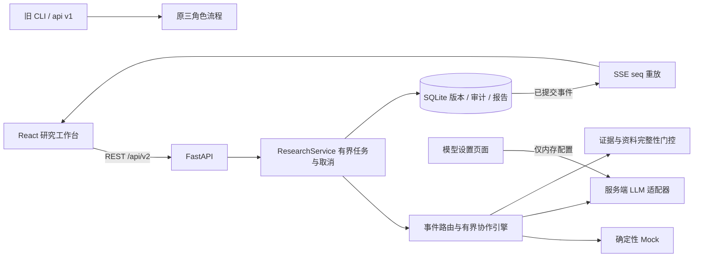

# MDT Lab V0.3 技术方案与后续开发计划

更新日期：2026-11-07。设计依据为用户提供的《最终方案.md》，早期《deep-research-report.md》作为背景参考；实施范围以“先把系统做成形，再写论文”为准。方案文档中的建议属于设计输入，不代表功能已完成或实验结果已得到验证。

## 当前完成到哪里

V0.3 已将原有三角色 CLI Demo 扩展为本地纵向研究工作台，主页面使用 `/api/v2`。旧 CLI、`/api/v1` 和旧报告继续可用，基础 Demo 入口为 `/legacy`。

| 最终方案中的能力 | 当前实现 | 尚未完成的部分 |
| --- | --- | --- |
| 纵向病例与事件记忆 | 版本化病例、追加事件、历史版本、按触发事件冻结输入 | 外部数据清洗和更丰富的病例语义 |
| 事件驱动调度 | 四角色注册表；按事件规则调度；固定全员对照 | 经独立标注验证的路由效果 |
| 专科审阅与协商 | 独立上下文；标签/事实/来源冲突；最多一轮定向讨论 | 更多基线、可配置消融与批量实验 |
| 证据与安全门控 | 服务端证据注册、引用与事实类型校验、缺失/冲突阻断 | 指南检索、医学语义核验与临床有效性验证 |
| LLM API | 服务端适配器、结构化输出、一次重试、调用指标、内存密钥 | 真实服务和具体模型的小样本联调 |
| 前端与实时流 | 病例库、工作台、运行、报告、历史、模型设置、SSE 恢复 | 长期运行和大规模数据下的性能验证 |
| 数据持久化 | SQLite 追加式记录；报告与终态原子提交；重启恢复历史 | 多进程任务队列、认证与部署运维 |
| 数据来源 | 3 个手工合成肺癌资料场景，来源明确 | Synthea、TCIA、TCGA 接入 |
| 研究结论与论文 | 已具备积累可追溯运行记录的工程基础 | 独立标注、正式实验、统计分析和论文 |

## 架构与模块边界

- **界面层**：React、Vite、TypeScript、React Router、TanStack Query、Zod。展示后端快照与事件，不在前端生成角色意见、Token 用量或最终标签。
- **接口与服务层**：FastAPI 统一提供静态页面和接口；`ResearchService` 管理两个工作线程、四个未完成任务上限、取消与超时。
- **领域层**：`research/engine.py` 接收冻结病例与运行请求，通过回调输出事件，不直接操作数据库；先以显式 Python 流程实现可测试的有界协作，当前未引入 LangGraph。
- **存储层**：`ResearchStore` 保存病例版本、唯一病程事件、运行请求、冻结输入、快照、审计与报告。普通追加和快照更新使用事务，报告与最后两条事件一次提交。
- **模型层**：`provider.py` 实现 OpenAI 兼容 Chat Completions，采用严格 JSON Schema 和服务端二次校验。测试使用注入的模拟 HTTP 上游。

任务状态与模型配置仍属于单个进程，SQLite 持久化不等于支持多 worker。当前保持本机单 worker 启动。

## 数据与时序规则

一个病例具有固定 `case_id`、递增 `version`、患者基本属性、病程 `timeline` 和来源 `provenance`。追加请求携带 `expected_version`；若其他操作已更新病例，返回 409，防止静默覆盖。

每次追加生成新的事件 ID 与病例版本，旧版本保留。页面新增记录由服务端标记为 `research_scenario_generator`、合成扩展和无原始外部记录 ID，不能伪装为公开数据原始记录。

运行固定 `case_id + case_version + trigger_event_id`。上下文按 `(occurred_at, event_id)` 截断，之后发生或排序在后的事件不可见。同日顺序目前以事件 ID 确定，这是技术排序约定，不是临床因果顺序。未来接入具有精确时间的数据时需要扩展时间与顺序建模。

证据 ID 为 `event_id:fact_key`，来源、数据版本、事实值由后端注册。报告内保存运行时的病例快照与证据注册表，证据弹窗读取冻结记录；后续新增事件不会改写旧报告。

## 协作与门控

| 触发事件 | 按事件模式参与角色 |
| --- | --- |
| 初始登记、进展、复发 | 肿瘤科、影像科、外科、病理科 |
| 影像、随访 | 肿瘤科、影像科 |
| 病理、分子检测 | 肿瘤科、病理科 |
| 手术/操作 | 肿瘤科、外科 |
| 治疗、用药、毒性、一般观察 | 肿瘤科 |

固定全员模式始终选择四个角色，便于观察参与者和调用数差异。这些角色当前核对科研记录的充分性与一致性，不承担诊疗或处方职责。

独立审阅后检测三类分歧：流程标签不同、同一事实的结构化断言不同、关键字段在最新日期存在相反来源值。后来的日期可以更新旧事实；同日有明确 `supersedes_event_id` 的记录可声明替代关系。其余同日冲突保留给人工核验。

只让具有有效意见且参与分歧的角色进入一轮讨论。各角色读取独立副本和同一份初始意见快照，避免讨论顺序改变其他角色可见的材料。讨论后重新检查，不以多数票消除冲突。

门控以本次选择的角色为分母，依次检查有效意见覆盖、证据匹配、未解决冲突、当前事件所需资料及时间边界。角色失败、非法引用或未解决矛盾均导向 `DEFER_DECISION`；存在资料缺口导向 `NEED_MORE_INFORMATION`；全部满足才允许 `READY_FOR_REVIEW`。完整性字段及其布尔规则属于实验条件，不能解释为临床指南。

## 模型、失败与可观察性

模型配置仅保存在服务端内存，启动运行时复制冻结。公开 HTTPS 目标检查、拒绝重定向、稳定错误代码和日志脱敏降低配置泄露风险；当前没有用户认证，仍限本机使用。

模型请求最多重试一次，错误输出不会被 Mock 替换。单次 HTTP 超时可配置 1–60 秒，研究运行默认 120 秒预算；总超时与取消在工作流边界检查，不能瞬间中断已经发出的同步 HTTP 请求。重启后未完成的任务记录为中断失败，历史报告保持可读。

指标分别记录角色调用数、模型请求数、工具执行数、重试次数、用量与耗时。Mock Token 为 `null`；上游不提供用量时保持未知。当前三个只读步骤是病程读取、证据注册/查询和缺失字段检查，不是外部医学知识工具。

SSE 发布已提交的审计事件，`seq` 在单次运行内递增。前端只确认连续序号，遇到缺口先缓冲、用 REST 补拉；快照以 `last_seq` 保持单调，断线重试超过约 30 秒提供手动重连。进度来自实际完成、运行中和待执行节点，不用计时器伪造百分比。

## 页面设计与验收原则

保留深绿、纸白的研究工具视觉体系。主要操作路径为病例 → 版本和触发事件 → 路由预览 → 运行 → 证据与报告，模型设置独立放置。四个角色明确区分参与、跳过、运行、失败，避免将跳过误认为异常。

验收必须同时覆盖正常和异常路径：资料逐步补齐、同日事实冲突、非法证据、角色失败、取消、重启恢复、版本追加、旧报告不变、SSE 重放、手机布局、主题和模型未配置状态。实际结果见 [验收记录](验收记录.md)，接口细节见 [API 与事件契约](API与事件契约.md)。

## 后续开发顺序

| 阶段 | 具体工作 | 完成条件 |
| --- | --- | --- |
| 1. 真实模型试运行 | 使用明确支持当前参数的提供方，固定模型/Prompt/配置，对少量合成场景执行正常、缺失、冲突与失败路径 | 保存脱敏运行记录；确认真实结构化输出、用量、耗时和错误处理；不把模拟 HTTP 测试当作真实联调 |
| 2. 数据导入与来源 | 先接 Synthea，统一事件字段与版本；再评估 TCIA/NSCLC-Radiogenomics、TCGA/cBioPortal 的许可、访问条件和可用字段 | 导入器可重复运行；每条记录追溯到数据版本与原始 ID；清楚区分原始、派生和合成扩展；不能拼接无共同患者标识的数据为同一真实病程 |
| 3. 场景与独立标注 | 制定必要专科、关键证据、缺失字段、预期冲突和流程状态标注；开发/测试按基础病例分组 | 标注不直接复制系统路由或模型输出；同一病例变体不跨数据划分；保留争议与复核记录 |
| 4. 基线与消融 | 实现单模型、固定多角色无定向协商、事件调度+协商、完整门控四组；分别移除路由、冲突、证据、事件记忆 | 同病例、模型、Prompt 与温度控制一致；批量结果可复算；保留失败与缺失用量，避免只挑成功样本 |
| 5. 先导与正式实验 | 先估计方差、成本和失败率，再确定样本量与重复次数；比较专科召回、引用有效率、缺失/冲突识别、调用成本与时延 | 输出配对统计、置信区间和误差分析；结果仅解释预定研究任务，不宣传临床有效性 |
| 6. 系统与论文交付 | 固定代码、数据、配置和实验产物，整理复现命令，再撰写论文与答辩材料 | 论文逐项引用真实实现和可复算结果；未完成能力列为限制或展望 |

当前阶段优先完成本地系统与证据链，不为排期提前填入实验结果。最终方案中开发集 20–30、测试集 60–100 个场景是规划建议，正式规模应由先导实验、可用标注和预算决定。

若后续要多人使用或公开部署，需要另行增加身份认证、隔离权限、可靠任务队列、持久化配置策略和部署验证；这些不属于当前本机 Demo 的完成项。

## 2026-11-12 阶段增量

本文此前的“尚未接入”描述为历史计划。本阶段已完成 Synthea CSV ZIP、TCIA 临床 CSV 与研究 JSON 的预检导入；接通外部数据页、来源与无日期资料展示、病例版本、Agent 群、SSE、证据与报告。新增 GitHub Actions 检查，原始数据与运行产物排除在版本库外。仍待开展真实模型小样本验证、数据映射扩展、独立标注和基线/消融实验。
